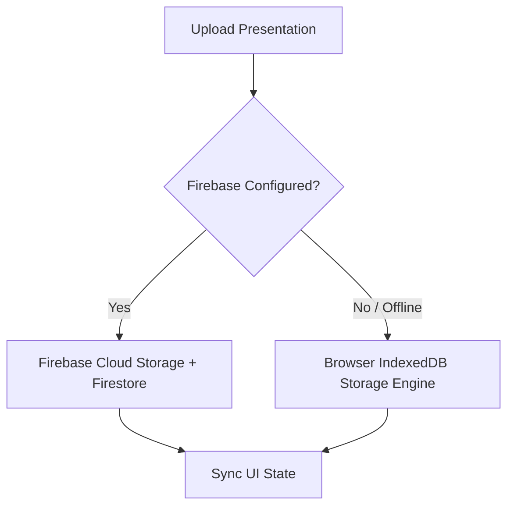

# Digital Logic and Computer Organization (DLCO)
### Interactive Learning and Presentation Portal

A modern, responsive, college-grade educational web application designed for computer engineering students and faculty. This platform delivers curriculum presentations for the complete **Memory Unit** with interactive slide decks, an in-browser PDF viewer, and presentation management tools for faculty.

---

## 🚀 Quick Start

### 1. Development Server
The application is pre-configured and ready to run:

```bash
# Install dependencies (if running for the first time)
npm install

# Start local development server
npm run dev
```

Open your browser at **[http://localhost:5173](http://localhost:5173)**.

### 2. Production Build
```bash
# Type-check and compile optimized production bundle
npm run build

# Preview production build locally
npm run preview
```

---

## 🎓 Faculty Credentials (Demo & Evaluation)

For evaluating faculty upload, replacement, and deletion workflows:

| Role | Email | Password | Access Level |
| :--- | :--- | :--- | :--- |
| **Faculty Coordinator** | `faculty@dlco.edu` | `Faculty@2026` | Full Courseware Admin |
| **Department Head (CSE)** | `hod.cse@dlco.edu` | `Faculty@2026` | Full Courseware Admin |
| **Lab In-Charge** | `arch.lab@dlco.edu` | `Faculty@2026` | Full Courseware Admin |

> **Note:** Any institutional `@dlco.edu` address with an 8+ character password will also grant faculty access in offline development mode.

---

## 📚 Curriculum Structure: 12 Memory Organization Topics

The portal includes all twelve syllabus topics organized in sequential curriculum order:

| # | Topic Title | Category | Status | Details |
| :-: | :--- | :--- | :-: | :--- |
| **01** | **Memory Hierarchy** | System Architecture | 🟢 **Available** | Complete 16-slide seminar deck + PDF preview |
| **02** | **Memory Classification** | Memory Fundamentals | 🟡 *Awaiting Upload* | Volatile/non-volatile, SRAM vs. DRAM, access modes |
| **03** | **Primary Memory (RAM) – With Mapping** | Primary Memory | 🟡 *Awaiting Upload* | 1D/2D decoding, memory expansion, chip select |
| **04** | **Primary Memory (ROM) – With Mapping** | Primary Memory | 🟡 *Awaiting Upload* | Mask ROM, PROM, EPROM, EEPROM, diode matrix |
| **05** | **Secondary Memory** | Storage Subsystems | 🟡 *Awaiting Upload* | HDD geometry, SSD flash translation, RAID levels |
| **06** | **Cache Memory** | Cache Architecture | 🟡 *Awaiting Upload* | Cache lines, tags, write-through vs. write-back |
| **07** | **Cache Memory Mapping** | Cache Architecture | 🟡 *Awaiting Upload* | Direct, associative, and set-associative mapping |
| **08** | **Cache Memory Policies** | Cache Architecture | 🟡 *Awaiting Upload* | MESI coherence protocol, snooping, write allocate |
| **09** | **Virtual Memory** | Virtual Memory & OS | 🟡 *Awaiting Upload* | Multi-level paging, inverted tables, TLB traversal |
| **10** | **Replacement Algorithms** | Algorithms & Policies | 🟡 *Awaiting Upload* | LRU hardware stack, FIFO, Belady's Anomaly, OPT |
| **11** | **Memory Management Requirements** | System Architecture | 🟡 *Awaiting Upload* | Relocation registers, protection, code sharing |
| **12** | **Memory Performance** | Evaluation & Benchmarks | 🟡 *Awaiting Upload* | Latency vs. bandwidth, interleaving, memory wall |

---

## 🌟 Key Features

### 👨‍🎓 Student Learning Area
- **12 Interactive Topic Cards**: Displays topic number, category chip, architectural summary, key syllabus concepts, and upload status.
- **Search & Filter Bar**: Real-time multi-attribute search (topic title, category, concepts, or topic number) with filter tabs (*All Modules*, *Available*, *Awaiting*).
- **Dual Presentation Viewer**:
  - **Embedded PDF Viewer**: Native browser document rendering with fallback download link.
  - **Interactive Slides**: Turn-by-turn slide deck navigation with arrow buttons, slide-dot jumpers, speaker notes callouts, and keyboard controls (`Left Arrow` / `Right Arrow`).
- **Direct Download**: Download published presentation decks (`.pdf`, `.pptx`, `.ppt`) to local devices.

### 👩‍🏫 Teacher Workspace & Management Console
- **Role-Based Access Control**: Strict client and route protection preventing unauthorized uploads or modifications.
- **Upload Seminar Decks**:
  - Drag-and-drop or file browser selection for PDF and PowerPoint files (up to 50 MB).
  - Optional custom description/annotation input.
  - Interactive upload progress indicator.
- **Safe Replacement**: Clear confirmation modal before overwriting existing courseware presentations.
- **Deletion Workflow**: Dedicated modal confirmation to remove presentations and update student views instantly.
- **Directory Table**: Comprehensive view of all 12 modules showing presentation status, file formats, file sizes, upload timestamps, and direct action triggers.

---

## 💾 Dual Storage Architecture

The portal is architected with a seamless fallback mechanism:



1. **Local Offline Engine (Default)**: Uses browser **IndexedDB** (`DLCO_Portal_Database`) to persist custom uploaded files and metadata across page reloads and browser sessions without requiring an external backend or cloud credentials.
2. **Cloud Backend (Optional)**: Connect your Firebase project to enable cross-device cloud synchronization.
   - Simply click **"Cloud Sync / Firebase"** in the website header or footer.
   - Paste your Firebase API credentials directly into the modal or create a `.env` file from `.env.example`.

### Firebase Environment Variables (Optional)
```env
VITE_FIREBASE_API_KEY="your-api-key"
VITE_FIREBASE_AUTH_DOMAIN="your-project.firebaseapp.com"
VITE_FIREBASE_PROJECT_ID="your-project-id"
VITE_FIREBASE_STORAGE_BUCKET="your-project.appspot.com"
VITE_FIREBASE_MESSAGING_SENDER_ID="your-sender-id"
VITE_FIREBASE_APP_ID="your-app-id"
```

---

## 🛠️ Technology Stack

- **Framework**: React 19 (TypeScript)
- **Build Tool**: Vite 6
- **Icons**: Lucide React
- **Storage**: IndexedDB API + Firebase SDK 11 (Auth, Firestore, Cloud Storage)
- **Styling**: Vanilla Modern CSS with CSS Custom Properties, flexbox/grid layout, and high-contrast accessible color scheme

---

## 📁 Project Structure

```
DLCO/
├── public/
│   └── presentations/
│       └── DLCO_Topic01_Memory_Hierarchy_Seminar.pdf  # Verified Topic 1 Seminar Deck
├── src/
│   ├── components/
│   │   ├── FirebaseConfigModal.tsx  # In-app cloud configuration modal
│   │   ├── Footer.tsx               # Academic footer with links & status
│   │   ├── Header.tsx               # Primary navigation bar & auth indicators
│   │   ├── HeroSection.tsx          # Homepage portal hero
│   │   ├── PortalEntries.tsx        # Student vs. Teacher portal cards
│   │   ├── PresentationViewer.tsx   # Dual PDF & Interactive Slide deck viewer
│   │   ├── TeacherLoginModal.tsx    # Secure faculty authentication dialog
│   │   └── TopicCard.tsx            # Topic card component
│   ├── context/
│   │   └── AuthContext.tsx          # Teacher authentication provider & session state
│   ├── data/
│   │   └── initialTopics.ts         # Full 12-topic curriculum definitions
│   ├── services/
│   │   ├── firebase.ts              # Firebase SDK integration
│   │   ├── indexedDbStorage.ts      # IndexedDB durable offline storage engine
│   │   └── storageService.ts        # Unified storage facade
│   ├── views/
│   │   ├── HomePage.tsx             # Academic landing page
│   │   ├── StudentDashboard.tsx     # Student learning area with search & filters
│   │   ├── TeacherDashboard.tsx     # Faculty management console
│   │   └── TopicDetailsPage.tsx     # Single topic study view & presentation player
│   ├── App.tsx                      # Root component & view router
│   ├── index.css                    # Complete responsive CSS design system
│   ├── main.tsx                     # React DOM entrypoint
│   └── types.ts                     # TypeScript definitions for topics, presentations & auth
├── scripts/
│   └── generate-sample-pdf.cjs      # Vector PDF generation utility for Topic 1
├── package.json
└── README.md
```
